# How to install and run a game on steam deck (machine)

In Desktop mode, go to [release page](https://github.com/pjohno/lepton-x86_64/releases) and download the latest `*.install.sh`, `*.tar.gz` and `*.tar.gz.sha256`.

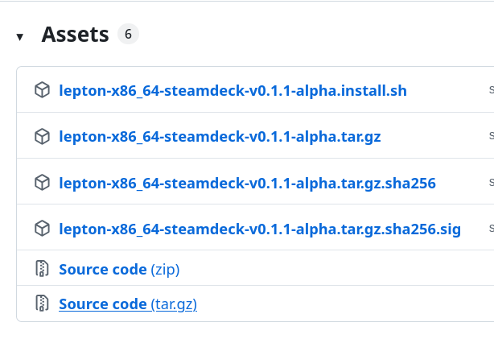

Assuming all three files in Downloads folder, open in Dolphin.

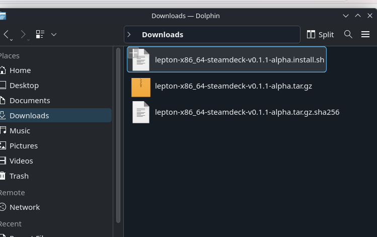

Double click on the install file. Accept to Launch and continue -- **no password is required at any stage**:

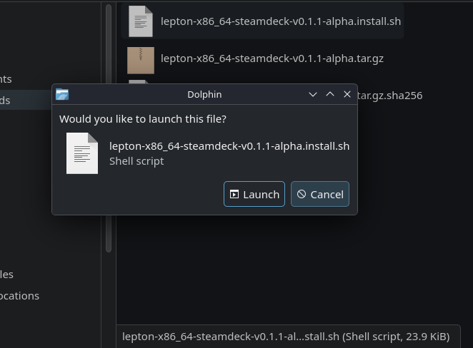

Alternatively you could run from the terminal.

Select to install the new tool
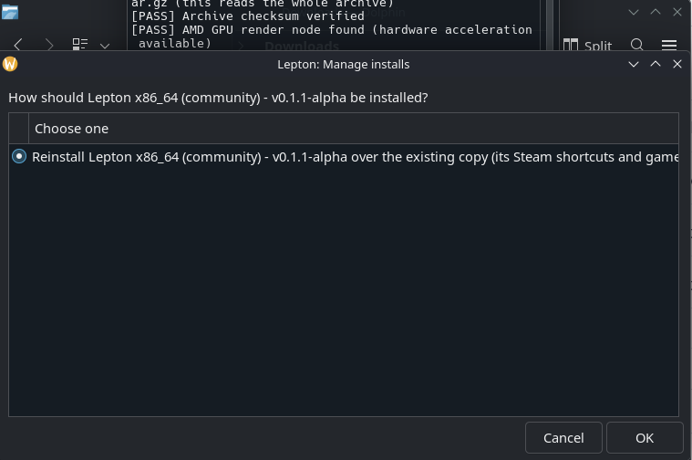

and you should see some shortcuts appear on the desktop.

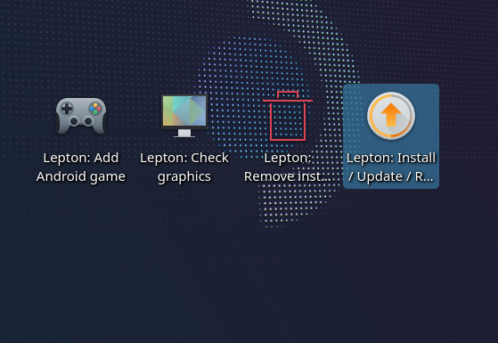

Now download an apk, it **must** be `universal` or `x86_64`, and most playstore apps won't work. Apps on [https://f-droid.org/](https://f-droid.org/) should all work. Roblox from the playstore is one game that does work. Download latest `*.apkm` and put it in a folder somewhere.

Then click on `Lepton:Add Android Game` and select your apk

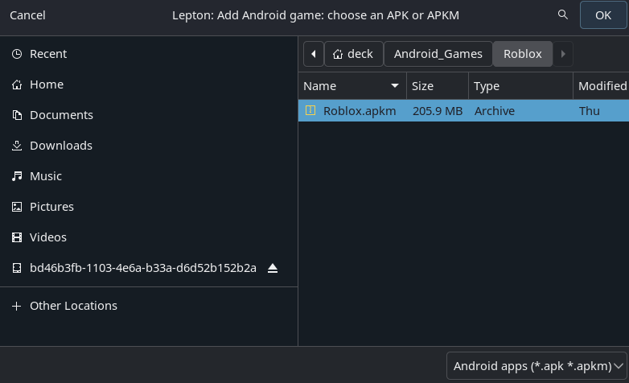

You need to close steam to add the shortcut

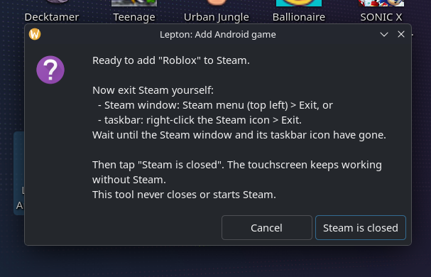

and the shortcut should be setup with lepton selected as the compatability tool.

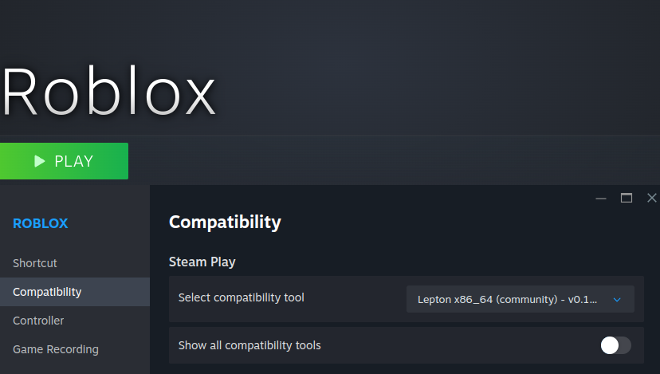

Click play in desktop mode to test

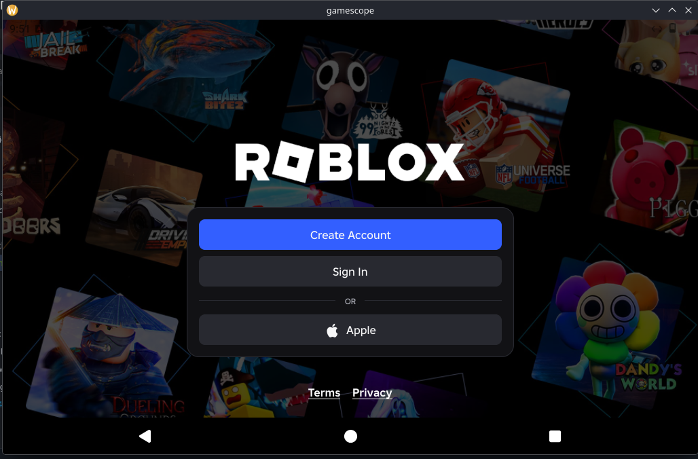

**NOTE** Touchscreen isn't working in desktop mode, so exit to gamemode.

Before starting the game, go to controller settings, `Edit Layout > Action Sets > Default > Add Always On Command > System > Touchscreen Native Support`. 

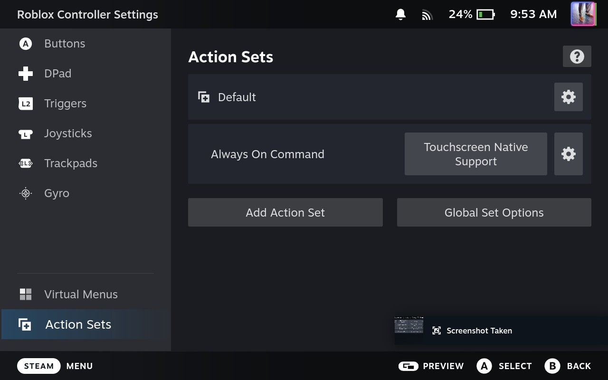

You should be able to touch the screen and it register now. The steam deck controller should be working as a gamepad in games.

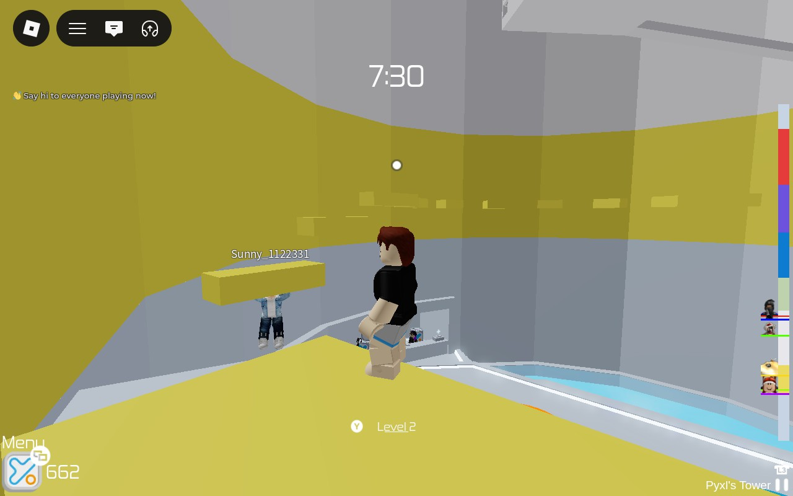

## Google Play launcher (GApps bundles only)

Release bundles have no Google services. If you install a GApps bundle you
built yourself ([GAPPS.md](GAPPS.md)), the installer asks **Would you like to
add Google Play to your Steam library?** If you answer **Add to Steam**:

1. Exit Steam when asked (Steam menu > Exit) and tap **Steam is closed**.
   Lepton never closes or starts Steam itself.
2. Optionally import artwork you downloaded yourself, for example from
   <https://www.steamgriddb.com/game/5451976>. Pick one file per kind; Cancel
   skips a kind.
3. Start Steam again. **Google Play (Lepton)** is under Non-Steam games.
4. Turn on **Touchscreen Native Support** in its controller layout (as above).

In Gaming Mode, launch it, sign in to Google, then install and play games from
the Play Store:
- Use **Steam + D-pad Left** (Esc, Android's Back) to return to Android's home
  screen, then open another game.
- Steam's **Stop** ends Android.
- Next time, your games, sign-in and saves are still there.

If you skipped it, add it later with **Lepton: Add Google Play to Steam**, and
artwork with **Lepton: Google Play artwork**.

Games installed this way share the Google Play shortcut's Android data. Games
added with **Lepton: Add Android game** have their own. Not every Play Store
game runs: ARM-only games need an NDK bundle, and games that need Play Integrity
don't work. See [GAPPS.md](GAPPS.md#google-play-in-steam).
