# How to install and run a game on steam deck (machine)

In Desktop mode, go to [release page](https://github.com/pjohno/lepton-x86_64/releases) and download the latest `*.install.sh`, `*.tar.gz` and `*.tar.gz.sha256`.

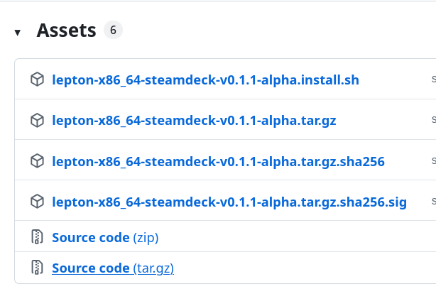

Assuming all three files in Downloads folder, open in Dolphin.

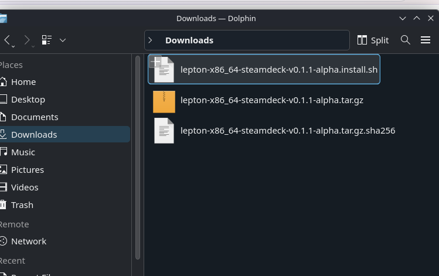

Double click on the install file. Accept to Launch and continue -- **no password is required at any stage**:

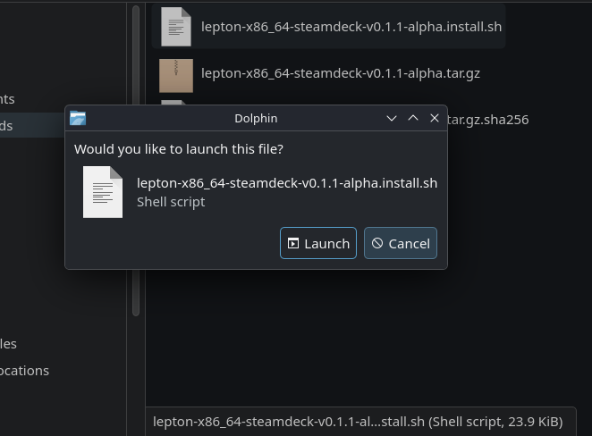

Alternatively you could run from the terminal.

Select to install the new tool
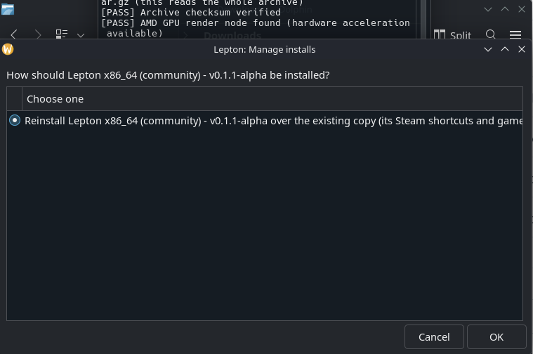

and you should see some shortcuts appear on the desktop.

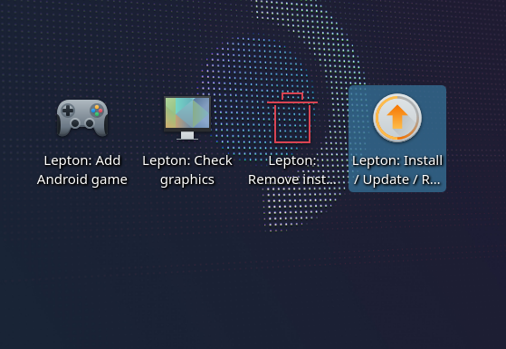

Now download an apk, it **must** be `universal` or `x86_64`, and most playstore apps won't work. Apps on [https://f-droid.org/](https://f-droid.org/) should all work. Roblox from the playstore is one game that does work. Download latest `*.apkm` and put it in a folder somewhere.

Then click on `Lepton:Add Android Game` and select your apk

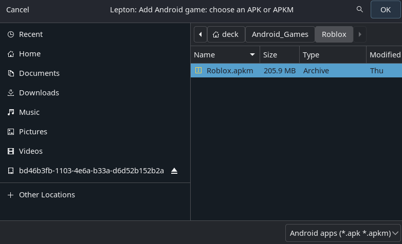

You need to close steam to add the shortcut

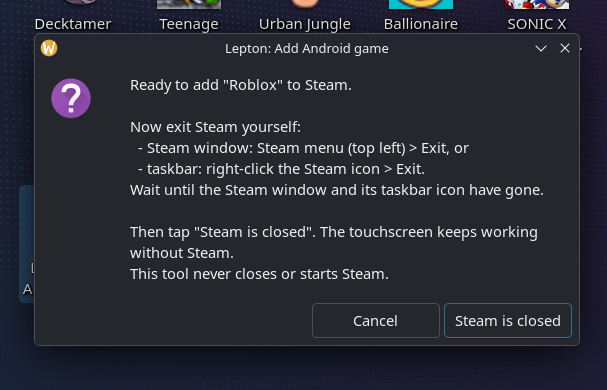

and the shortcut should be setup with lepton selected as the compatability tool.

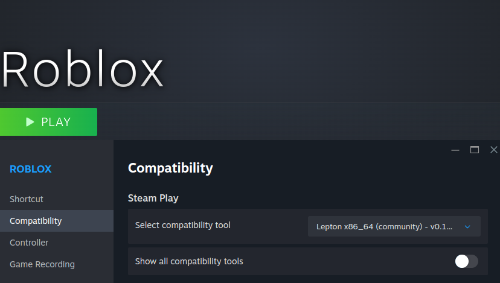

Click play in desktop mode to test

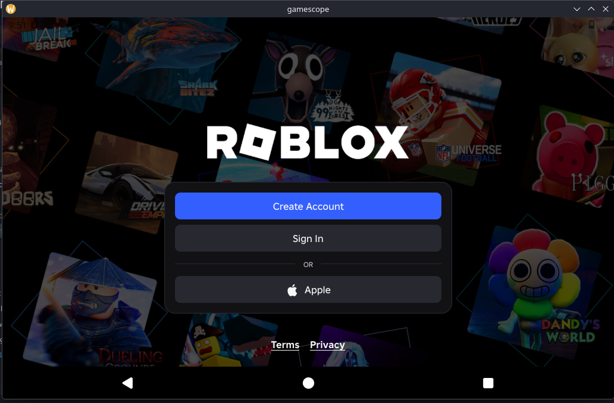

**NOTE** Touchscreen isn't working in desktop mode, so exit to gamemode.

Before starting the game, go to controller settings, `Edit Layout > Action Sets > Default > Add Always On Command > System > Touchscreen Native Support`. 

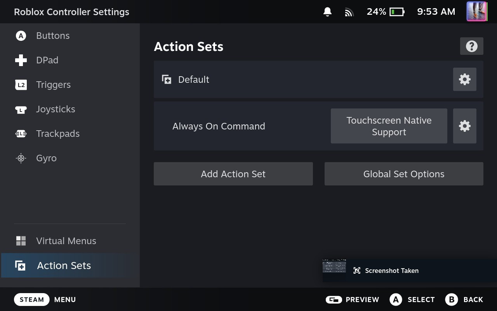

You should be able to touch the screen and it register now. The steam deck controller should be working as a gamepad in games.

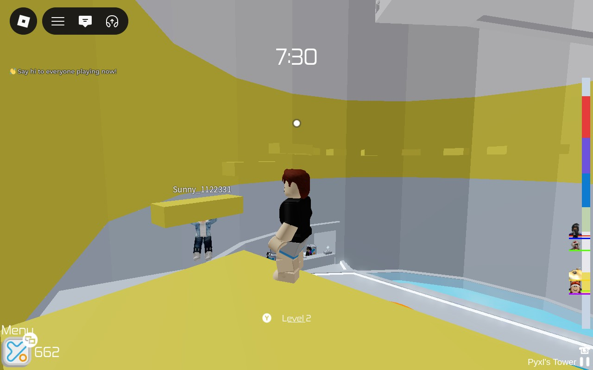